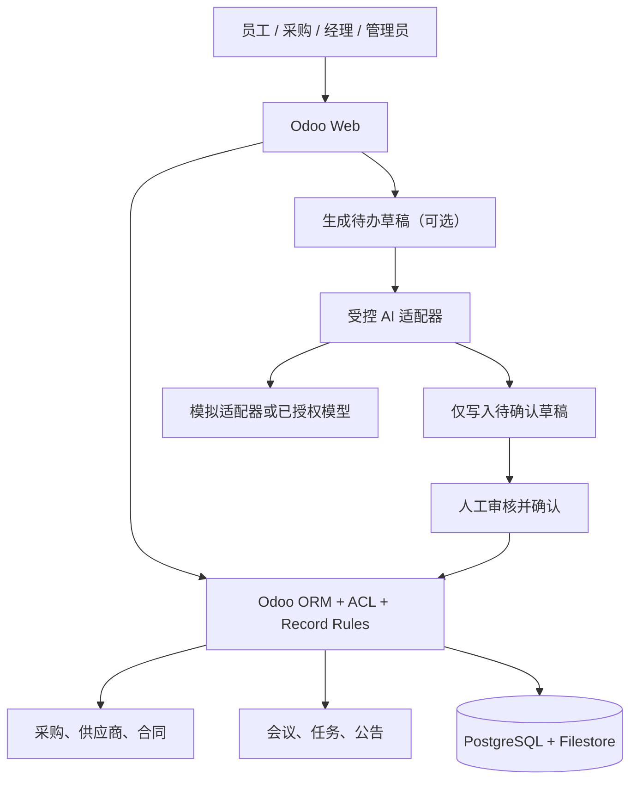

# 显微镜企业办公系统 · Agent 执行方案（可直接交接）

**状态：** 开发执行基线 v1.0 / 2026-11-13  
**工作性质：** 售前需求验证型 MVP → 客户确认后另行进入付费试点；**不是生产上线承诺**  
**依据：** 客户已表达的三类需求；此前 `MVP_PLAN.md` / Odoo × Agent HLD v0.1；《项目工程设计_原文转写.md》；针对工程设计的后续审查。  
**优先级规则：** 本执行方案约束 Agent 的实际实现边界。原始工程报告是技术候选方案及报价参考，**不是必须逐项完成的工作清单**。客户未确认的事实一律记为假设，不得包装成已确认需求。

---

## 0. 给执行 Agent 的顶层指令

你是一名熟悉 Python、Odoo ORM、PostgreSQL、Docker、Web 安全及 LLM 工具集成的工程代理。目标不是做一套完整 ERP，而是交付**能在本地演示、能重复部署、能验证客户业务价值**的办公 MVP，重点覆盖：

1. **供应商 / 询报价 / 采购单 / 合同台账**：不重新实现 Odoo 原生采购引擎。
2. **员工账号与业务权限**：明确哪些角色能查看采购底价、合同、会议和公告。
3. **会议纪要 / 待办 / 内部通知**：这是客户明确提出的需求，**不得因为原工程报告更强调审批活动而遗漏公告发布**。
4. **有限 AI 辅助**：优先只做“会议文本 → 待确认行动项草稿”；AI 失败后人工流程照常工作。

### 授权边界

- **可以自主执行：** 阅读现有代码、构建本地项目、添加单元/集成测试、创建模拟数据、编写文档、启动**本地**容器、完成演示流程。
- **不得自行执行：** 访问客户生产系统、导入真实员工/合同/供应商敏感数据、公开部署、发送真实邮件/短信/IM、发起实际采购/合同审批/付款、使用真实采购数据调用外部 LLM、创建付费云资源、承诺工期/价格/SLA。
- 不需要为每次常规本地编辑请求确认。遇到**付费、对外通信、生产数据、高权限认证、破坏性迁移、客户权限或交付承诺**则停止相应操作，记录阻断条件。
- 不得因本方案未给出账号、API Key、云服务器、客户组织架构而伪造凭据或补全为“事实”。

### 工程完成判定

只有**程序能运行、验收测试通过、演示脚本走通、代码与文档可复现**才算开发完成；生成设计文档、截图或空接口不算实现。所有宣称的测试结果必须来自实际执行，不得虚构。

---

## 1. 真实业务问题与边界

### 1.1 已知客户需求（仅限已明确表达的内容）

| 客户原话层级 | 要解决的业务问题 | MVP 的最低验证动作 | 尚未确认的部分 |
|---|---|---|---|
| 多供应商联系、采购、合同 | 信息散落、询报价和合同难追溯 | 创建供应商、询价单、采购单、关联合同，按权限查询 | 对外主要用微信/邮件/电话？是否需要自动比价、催办、真实通信同步？ |
| 人事权限 | 不同人看不同业务信息 | 创建测试员工与角色，证明未授权账号读不到敏感记录 | 是否涉及考勤、入离职、假期、薪酬、组织层级？ |
| 会议记录、通知 | 会后任务易丢失、公告未形成统一入口 | 会议文本保存→待办确认→任务分派；经理发布公告、员工查看 | 是否需要已读回执、推送到飞书/企微、会议语音转写？ |

**业务成功指标（待客户确认）：** 员工能找到目标记录；采购进度可追溯；管理者可追责但不能越权审批；会议行动项能找到责任人和截止日；通知确实可被目标员工看到。不要把“调用了六个 AI 工具”当作价值指标。

### 1.2 首期明确不做

- 财务总账、会计报税、工资、考勤、库存 / BOM / MES、设备控制、供应商对外门户、电子签章、自动付款。
- 复杂金额阶梯、多级会签、定制采购审批引擎。**先验证 Odoo 原生审批路径和客户实际流程**。
- 飞书、企业微信、钉钉、Telegram 的正式双向集成；演示入口先采用 Odoo Web。
- 全量合同解析、自动选供应商、自动批准或正式发出采购单。
- 生产级多租户、高可用、7×24 支持、企业完整审计合规认证。

---

## 2. 推荐架构与版本决策



**架构纪律：**

- Odoo 是唯一业务事实来源；合同、采购单、用户、会议和公告均由 Odoo ORM 管理。
- Agent 是辅助层，不拥有独立的“第二份采购数据库”。所有关键业务写入由确定性的 Odoo 方法完成。
- 优先在 Odoo add-on 内实现 MVP 业务流程；**不要为概念完整性强行建立 FastAPI 微服务**。独立网关仅在有明确跨平台接入、隔离或复用需求时引入。
- 模型输出不可信；不能直接把模型返回的人员 ID、价格、权限、方法名变成高权限操作。
- 菜单/按钮隐藏是用户体验，不是安全控制；服务端 ACL、record rules、字段权限和公开方法校验必须真正生效。

### 2.1 Odoo 版本不能提前锁死

原始工程报告推荐 **Odoo 18 Community**；此前 MVP 计划还提到了 **Odoo 20 兼容性烟测**。这两者是不同技术基线。

执行规则：

1. 先检查已有仓库、现有 Docker 配置、客户已购系统、Odoo 版本和现成模块。
2. **若是全新本地演示项目**，可以先用 Odoo 18 Community 作为建议基线，但须实际完成安装与模块测试。
3. **若仓库已采用 Odoo 20 或其他版本**，不得擅自降级。先记录兼容性和迁移成本，再选择单一测试基线。
4. 不承诺一套 add-on 同时支持 18/19/20；没有执行测试就不能写“全版本兼容”。
5. 禁止假定 Odoo Online 能安装自定义 Python add-on。涉及外部 API 时，区分外部 `/jsonrpc` RPC 服务与 Odoo Web JSON-RPC 控制器；按实际版本确认协议和授权能力。

**官方参考（须在对应版本复核）：**

- Odoo 18 安全机制：https://www.odoo.com/documentation/18.0/developer/reference/backend/security.html
- Odoo 19 RPC 弃用说明：https://www.odoo.com/documentation/19.0/developer/reference/external_rpc_api.html
- Odoo 19 JSON-2：https://www.odoo.com/documentation/19.0/developer/reference/external_api.html

---

## 3. 交付阶段与先后顺序

### G0 — 代码与环境侦察（先于编码）

**任务：**

- [ ] 确认工作区是否已经存在工程；阅读 `README`、`AGENTS.md`、现有 Makefile、Compose、依赖和 CI。
- [ ] 列出现有功能、可运行性、Odoo 版本、数据库、扩展模块、外部服务需求。
- [ ] 对照原工程报告，制作 `docs/FIT_GAP.md`：原生支持 / 少量配置 / 必须定制 / 暂不开发。
- [ ] 创建 `docs/DECISIONS.md`，记录选用版本、原因及未决事项。
- [ ] 使用 git 新分支（如项目允许），**不覆盖现有未提交工作**。

**输出：** `docs/BASELINE.md`、`docs/FIT_GAP.md`、`docs/DECISIONS.md`、具体开发任务清单。  
**过关条件：** 当前状态有证据；能解释为何选择具体 Odoo 版本；无真实客户数据和未知外部依赖。

### G1 — 不含 AI 的可运行 Odoo 基座

**任务：**

- [ ] 准备 `compose.yaml`、`.env.example`、本地数据卷、启动脚本和最小 README。
- [ ] 启用原生 Contacts、Purchase、Project，以及实际版本中可用的基础员工目录/消息功能。
- [ ] 创建一个业务 add-on（建议技术名 `microscope_office_mvp`；已有模块则在既有结构中演进）。
- [ ] 在本地初始化**模拟**供应商、用户、物料、采购订单和合同。
- [ ] 完成 add-on 安装、重装、升级、数据库初始化与日志检查。

**输出：** `docker compose up -d` 可启动；数据库、Odoo、模块可用；`scripts/seed_demo.py` 或 Odoo demo XML。  
**过关条件：** 一个开发者在干净环境中仅通过 README 指令能重现演示；数据库不暴露公网；无明文密钥提交。

### G2 — 三类业务最小闭环（P0，最优先完成）

#### G2-A：供应商、询报价、合同

- [ ] 直接复用 `res.partner`、`product.product` / `product.template`、`purchase.order`、`purchase.order.line`。
- [ ] 演示：三家供应商、至少两张 RFQ、一张已确认/待审批采购单，具体取决于已选 Odoo 版本的原生配置。
- [ ] 建立轻量合同台账模型 `mops.contract`（也可使用已存在且稳定的同等模型），字段至少含 `name`、`title`、`partner_id`、`responsible_user_id`、`date_start`、`date_end`、`state`、与采购单关联。
- [ ] 对附件只使用 Odoo 合法关联机制（`ir.attachment`）；最小闭环可先存合同元数据、模拟附件。
- [ ] 合同到采购单的关联基数先按一个合同可关联多张订单设计；如客户要求复杂 N:N 或多个签署主体，升级为待确认需求。
- [ ] 不发送真实询价邮件，不实际确认真实采购。

**验收：** 采购人员创建询价并关联合同；普通员工不能读取合同正文与受限报价；经理能看到授权范围内的进度。

#### G2-B：账号、角色和权限

建议的演示角色：`staff`（普通员工）、`procurement`（采购）、`manager`（负责人）、`admin`（系统配置）。角色只用于演示，正式角色以客户组织为准。

- [ ] 使用 Odoo 标准 `res.users`、`res.groups`、`ir.model.access.csv`、`ir.rule` 建立角色约束。
- [ ] 合同、采购、会议、公告分别制定模型级和记录级访问矩阵。
- [ ] 如果需要员工看自己的采购申请，明确新增 `requester_user_id`；**不得把 `purchase.order.user_id` 直接当作申请人**（原生字段偏向采购负责人）。
- [ ] 对单价和底价做真实字段 / 业务接口隔离；单靠采购单记录可见性或 UI 隐藏不够。
- [ ] 对审批、状态切换和批量发布等公开方法实施服务端组/状态/记录权限校验；不能仅在 XML 视图隐藏按钮。
- [ ] 禁止对外部请求直接信任传入的 `user_id` 或执行全局 `sudo()`。
- [ ] 先核实原生采购 `button_confirm`、`button_approve`、锁单及通知行为，再决定是否需要补丁；不得依据原文直接覆盖所有方法。

**验收：** 以各个真实测试账号直接调用 ORM/接口验证；无权限时必须返回拒绝，而不是只看不到菜单。

#### G2-C：会议、任务和内部公告

- [ ] `mops.meeting`：会议标题、时间、主持人、纪要文本、参与者、状态。
- [ ] `mops.meeting.action`：行动项文本、责任人候选文本、人工确认的用户、截止日期、选中状态、已生成 `project.task` 关联。
- [ ] 用户可手工录入行动项，并由授权人员**确认后**生成正式 `project.task`。
- [ ] 生成任务过程必须幂等；重复点击不得产生重复任务。
- [ ] 使用 `project.task` 或 `mail.activity` 跟进状态，**不要再建一份独立且不同步的任务库**。
- [ ] **不可遗漏公告：** `mops.notice` 至少支持草稿/已发布/归档、标题、正文、发布者、发布时刻、接收范围；员工只能读到允许范围内的已发布公告，非授权用户不得发布。
- [ ] 可选阅读确认：如无高成本，追加 `mops.notice.read`（用户/公告/时间唯一）；否则明确标为 P1，并在演示中注明未实现。

**验收：** 会议 → 手工录入 2 条行动项 → 人工确认 → 分配任务 → 查看任务；经理发布公告 → 普通员工可见；普通员工不能发布或访问草稿公告。

### G3 — 一项受控 AI 功能（P1，业务闭环已通过才做）

**唯一必优先实现的 AI 用例：** `会议纪要文本 -> 结构化行动项草稿`。

- [ ] 定义模型无关的输入/输出 Schema（标题、摘要、行动项数组、候选责任人名称、候选日期、原文证据片段、歧义标识）。
- [ ] 开发 `FakeLLMAdapter` 或 `RuleBasedDemoAdapter`，在无外部 API Key 的环境下也能完成演示和测试。
- [ ] 如已获授权，再接入可替换的真实模型适配器；未经同意不得将真实敏感材料发送第三方。
- [ ] AI 只写 `mops.meeting.action` 草稿。`assignee_user_id`、`deadline` 和最终任务生成须经过人工确认。
- [ ] 输入长度、输出字段、数量上限、超时、重试、空响应、错误类型都要有确定性约束。
- [ ] 当模型不可用或解析失败时，不修改既有正式任务；用户仍能手工创建行动项。
- [ ] 仅在该用例稳定后，才考虑采购订单只读查询工具；查询必须完全遵守当前账号的访问控制。

**接口建议（示意，不是固定 URL）：**

```json
{
  "meeting_id": 12,
  "summary": "确认供应商交期与规格",
  "actions": [
    {
      "title": "向供应商确认物镜交期",
      "suggested_assignee_name": "采购同事",
      "suggested_deadline": "2026-11-20",
      "source_excerpt": "采购同事下周五前确认交期",
      "ambiguous": false
    }
  ]
}
```

**验收：** AI 只产生可编辑草稿；不创建真实采购单、不批准合同、不修改权限；用户确认后才生成任务；重复确认幂等；模型失败后可人工继续。

### G4 — 测试、文档、现场演示准备（P0/P1 每次均运行）

- [ ] 自动测试覆盖访问控制、关键业务状态、合同关联、通知发布和任务生成幂等。
- [ ] 准备一组固定模拟数据、4 个测试账号和清理 / 重置流程。
- [ ] 输出 `docs/DEMO_SCRIPT.md`（5–8 分钟演示脚本）、`docs/TEST_REPORT.md`（实际执行命令与结果）、`docs/KNOWN_LIMITATIONS.md`。
- [ ] 无 AI Key 可全程演示手工路径；有 Mock 可演示 AI 草稿路径。
- [ ] 本地运行安装/升级/启动/重启烟测；若无法运行则记录 blocker，**不得把“静态推断通过”写为“测试通过”**。
- [ ] 用演示结果准备客户反馈问题，不把售前演示自动升级为客户交付。

**验收：** 运行步骤可复现；全部 P0 验收场景可演示；失败路径有明确现象和错误信息。

### G5 — 客户确认后才启动的付费试点（独立决策门）

只有在以下信息有书面确认后，才开始生产化计划：

- 客户现有 Odoo/ERP、部门和员工数量、实际采购审批流程、合同关联关系。
- 采购与供应商沟通使用的渠道、最耗时的真实工作、是否需要报价对比或自动跟进。
- 人事权限涉及哪些敏感字段、谁有管理员权限、谁可以查看底价和合同。
- 公告需不需要已读确认及 IM 推送；会议记录来源及谁负责校对。
- 部署地点、数据分类、合同/人事数据合规要求、预算、签约主体、付款方式、运维责任。

**付费试点推荐：** 选一个客户认可的真实痛点闭环作为一期，例如“询价→审批→合同→进度提醒”，而非一次上线全套系统。明确范围冻结、验收样例、变更收费、测试与生产隔离、备份恢复、HTTPS、安全审计、故障响应和验收后的维保条款。

---

## 4. 推荐仓库布局（已有仓库时按实际结构调整）

```text
microscope-office-mvp/
├── AGENTS.md                     # 可从本执行方案提炼，不覆盖用户已有 AGENTS.md
├── README.md
├── compose.yaml
├── .env.example
├── .gitignore
├── addons/
│   └── microscope_office_mvp/
│       ├── __init__.py
│       ├── __manifest__.py
│       ├── models/
│       │   ├── contract.py
│       │   ├── meeting.py
│       │   ├── meeting_action.py
│       │   ├── notice.py
│       │   └── purchase_order.py       # 仅确实需要新增字段/守卫时使用
│       ├── security/
│       │   ├── security.xml
│       │   └── ir.model.access.csv
│       ├── views/
│       │   ├── contract_views.xml
│       │   ├── meeting_views.xml
│       │   ├── notice_views.xml
│       │   └── menu.xml
│       ├── demo/
│       │   └── demo_data.xml
│       └── tests/
│           ├── test_access.py
│           ├── test_contract.py
│           ├── test_meeting_actions.py
│           └── test_notice.py
├── ai/                            # P1；也可作为 add-on 内的 service/adapter
│   ├── schema.py
│   ├── adapters.py
│   └── tests/
├── scripts/
│   ├── bootstrap.sh
│   └── smoke_test.sh
└── docs/
    ├── BASELINE.md
    ├── DECISIONS.md
    ├── FIT_GAP.md
    ├── ROLE_MATRIX.md
    ├── DEMO_SCRIPT.md
    ├── TEST_REPORT.md
    ├── KNOWN_LIMITATIONS.md
    └── CUSTOMER_DISCOVERY.md
```

**注意：** 最初先实现业务动作，再提取可复用模块；不为了目录齐全而生成空文件。不得把 API Key、客户文件、数据库导出或本地机密写入 git。

---

## 5. 验收用例（必须可机器验证或现场重演）

| 编号 | 场景与输入 | 预期结果 | 优先级 |
|---|---|---|---|
| AC-01 | 空目录/干净数据卷按 README 启动 | Odoo、DB、业务模块安装成功；界面可访问；无公网数据库端口 | P0 |
| AC-02 | 新建 3 家模拟供应商，创建至少 2 张 RFQ | RFQ 在 Odoo 采购模块可查询，关联正确，无真实消息外发 | P0 |
| AC-03 | 采购人员建立合同并关联采购单 | 编号、合同方、日期、责任人可追溯；普通员工无权读合同 | P0 |
| AC-04 | `staff` 从界面和 ORM/接口访问禁读合同、底价 | 服务端拒绝；不因菜单隐藏而假阳性 | P0 |
| AC-05 | `manager` 审批模拟采购单（如启用原生审批） | 仅合法状态和授权人可操作；自审策略按已确认规则执行 | P0/条件 |
| AC-06 | 录入会议纪要及 2 条手工待办并确认 | 创建正确的 `project.task`；再次点击不重复创建 | P0 |
| AC-07 | `manager` 发布模拟公告；`staff` 查看 | 草稿不可见；发布后按接收范围可见；`staff` 不可发布 | P0 |
| AC-08 | 禁止实际 LLM 请求，用 Fake Adapter 提取行动项 | 只产生可编辑草稿；尚未创建正式任务 | P1 |
| AC-09 | AI 超时、返回非法 JSON、错误责任人 | 不破坏既有数据；记录可诊断错误；支持手工修正 | P1 |
| AC-10 | 关闭重启容器，重新运行基础测试 | 数据和附件保持一致；演示可重现 | P0 |
| AC-11 | 备份/恢复、HTTPS、监控、RTO/RPO 演练 | 有生产试点合同和环境后再做，不作为售前 Demo 已完成事项 | 付费试点 |

### 权限测试额外检查

- 测试每个模型的 `read/create/write/unlink`，尤其是直接 ORM / RPC 访问。
- 测试记录级隔离和字段级保密；不要只断言 HTTP 成功或菜单可见。
- 测试审批公共方法的直接调用，不允许普通员工通过接口执行。
- 测试越权改变 `state`、`assignee_user_id`、`published_at`、`approved_by_id` 的写入。
- 对 Odoo 中的 `sudo()`、原始 SQL 和未受限公开方法进行全仓审查。

---

## 6. 风险与必须纠正的原报告假设

| 风险 | 原报告中的倾向 | Agent 应采取的行动 |
|---|---|---|
| 需求错位 | 更重审批和 Agent 工具，遗漏独立公告闭环 | 保留 `mops.notice` 和权限测试；验证客户真正需要的通知方式 |
| 采购负责人 vs. 申请人 | 直接把 `purchase.order.user_id` 当申请人 | 查询具体版本字段定义；必要时加独立申请人字段 |
| 只靠界面拦权限 | 隐藏按钮、限定打印即可解决越权 | 服务端 ORM、模型/记录/字段访问及方法守卫共同校验 |
| 审计不可篡改 | `mail.thread` + `tracking=True` 被表述为天然不可篡改 | 只能宣称普通操作日志；生产级防篡改须专门设计 |
| 单用户 API Key 透传 | 认为把 uid/API Key 传给网关即可安全继承权限 | P0 避免这一复杂路径；P1 坚持强认证、最小权限、服务端重验 |
| 微服务过早 | 首期必须单独部署 FastAPI Agent 网关 | 先在 Odoo add-on 内用可替换适配器闭环；有跨平台理由再拆分 |
| 版本先验 | 直接选 Odoo 18、假定迁移成本可忽略 | G0 调查后记录 ADR，测试实际所选基线 |
| 工期过于确定 | 20 人天被当作完整交付基线 | 作为原报告的粗估，不是承诺；以实测工作项和客户范围重估 |
| 供应商沟通 | Odoo 供应商档案等同沟通自动化 | 现场确认沟通渠道及是否需要邮件、聊天记录、OCR 集成 |
| 备份可靠性 | 只写 `pg_dump` 与附件打包 | 正式使用前必须验证数据库和 filestore 一致性及恢复流程 |

**涉及独立 RPC 服务时：** Odoo 官方将 `/xmlrpc*` 与外部 `/jsonrpc` RPC 服务标记为弃用，目标由 JSON-2 替换；Odoo Web JSON-RPC 控制器不能简单等同处理。只按实际版本和部署模式决定连接方式。参见第 2 节官方文档。

---

## 7. Agent 工作节奏、工时与汇报格式

### 7.1 推荐次序（依赖而非承诺日期）

| 工作片段 | 完成后必须交付 | 合理的人天区间（初估） |
|---|---|---:|
| G0 基线检查和 Fit-Gap | 事实清单、版本 ADR、可运行说明 | 1–2 |
| G1 Odoo 底座 + 模拟数据 | 可安装环境、演示种子数据 | 2–4 |
| G2 采购合同 + RBAC | 合同视图、服务端权限测试 | 4–8 |
| G2 会议、任务、公告 | 闭环视图、幂等测试 | 3–6 |
| G3 可选 AI 草稿 | Mock/授权适配器、错误回退 | 2–4 |
| G4 综合测试和文档 | 可复现报告、演示脚本 | 2–4 |

**说明：** 以上约 14–28 人天是本地 MVP 的粗略计划范围，不包括全面客户访谈、生产部署、安全验收、数据迁移、实施培训和长期运维。它与原文的“20 人天生产试点基线”口径不同，**不可直接拿去对客户报固定价**。若发现版本兼容或底层权限问题，需按实际证据重估。

### 7.2 每完成一个门禁，输出固定报告

```text
[Gate] G0/G1/G2/G3/G4
[状态] PASS / PARTIAL / BLOCKED
[本次修改] 文件、业务行为、核心设计决策
[验证证据] 执行的命令、测试数、成功/失败、截图或日志路径
[尚存问题] 按严重度列出；不隐藏失败
[下一步] 下一可执行动作
[待客户确认] 仅与当前门禁有关的业务决策
```

- 不允许用“全部完成”代替具体结果。
- 有真实 blocker 时保留可以独立运行的部分，不做虚假完成宣告。
- 遇到未明确需求，优先做**最小可逆实现**并记录 `ASSUMPTION`，不主动扩展复杂功能。

---

## 8. 客户访谈的 8 个关键问题（不阻断本地模拟演示）

1. 实际采购流程是什么？询价、比价、下单、验收各由谁负责？是否一定要审批？
2. 供应商日常通过什么渠道联系？最浪费时间的是联系、录入、比价、追交期还是整理合同？
3. 公司现有使用的 Odoo / ERP、Excel、飞书、企业微信等系统有哪些？希望替换还是打通？
4. 首期多少员工使用？谁能看到供应商底价、合同扫描件、员工敏感信息？
5. 合同是一单一份、框架合同多单，还是涉及变更、付款节点、质保及履约提醒？
6. 会议资料来自手工纪要还是语音转写？希望谁确认任务？通知要在什么位置出现、是否需要已读回执？
7. 能接受只读 AI 和人工确认吗？允许哪些数据进入外部模型？
8. 预算范围、交付日期期望、部署方式、签约与运维要求是什么？

**下一步商业判断：** 当客户回答后，以最耗时的单一业务闭环为付费试点范围；将其他需求列入二期候选和增项清单。报价须附工作项、验收标准和变更机制。

---

## 9. 给 Agent 的首条可执行任务

> 读取同目录的《项目工程设计_原文转写.md》，以本文件为执行优先级。首先检查当前工作区是否存在可用的 Odoo 工程与 Git 状态；若不存在，建立独立的本地演示项目。完成 **G0** 并继续执行 **G1**，在不使用真实客户数据、无付费服务、无公网部署的条件下把 Odoo + PostgreSQL + 自定义 add-on 跑起来，创建 3 家模拟供应商和测试角色。随后优先做 **G2 的三类业务最小闭环**（采购与合同、权限、会议/任务/公告），执行相应安全测试。只有 P0 演示能够完整走通时，再增加 **G3 的 AI 草稿提取**。每个门禁按第 7.2 节报告实际执行结果，不得把尚未运行的代码称为已验证。不要未经授权进行生产操作、承诺工期或扩展需求。

**完成定义：** 客户能在本地演示中亲眼看到三类问题被怎样管理，并能指出哪条流程值得付费试点；而不是得到另一份空泛的 ERP/Agent 架构报告。
